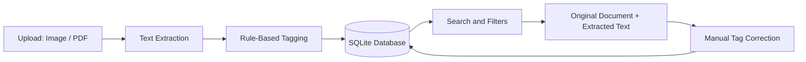

# Heritage Archive: Turning Scans, Photos and PDFs into a Searchable Record

**Built for HackCult '26**
**Problem ID:** HC26-CULT01 – Digital Revitalisation of Unstructured Cultural & Architectural Heritage Archives
**Team:** Hackedaf

## Problem Targeted

Cultural and architectural heritage records are scattered across photographed inscriptions, scanned manuscripts, survey PDFs and handwritten notes.

These records are difficult to search, organize and cross-reference, making valuable historical information difficult to access and preserve.

## What Our Project Does

Heritage Archive transforms unstructured heritage documents into an organized, searchable digital archive.

Key features:

* Upload images and PDFs (multiple files supported).
* Extract text from PDFs using their existing text layer.
* Use Tesseract OCR to extract text from scanned documents and photographs.
* Support English, Hindi and Marathi OCR.
* Automatically suggest document categories, historical eras, locations, languages and keywords.
* Store extracted information in an SQLite database.
* Search records using text, tags and locations.
* Filter records by category and historical era.
* View original documents alongside extracted text.
* Manually edit titles and tags to improve record accuracy.

## System Architecture



## Database Schema

The project uses SQLite with three main tables:

* **items:** Stores document information, filenames, extracted text, category, era, location, language and creation date.
* **tags:** Stores unique keywords and tags.
* **item_tags:** Connects documents with tags using a many-to-many relationship.

## Project Structure

```text
Heritage-Archive/
│
├── app.py
├── requirements.txt
├── schema.sql
├── README.md
├── .gitignore
│
├── services/
│   ├── __init__.py
│   ├── db.py
│   ├── ocr.py
│   └── tagger.py
│
├── templates/
│   ├── base.html
│   ├── index.html
│   ├── item.html
│   └── upload.html
│
├── static/
│   └── css/
│       └── style.css
│
└── tests/
    └── test_tagger.py
```

## Technologies and Libraries

| Technology    | Purpose                        |
| ------------- | ------------------------------ |
| Python        | Backend development            |
| Flask         | Web application framework      |
| SQLite        | Database management            |
| Tesseract OCR | Text extraction from images    |
| PyMuPDF       | PDF text extraction            |
| pytesseract   | Python interface for Tesseract |
| Pillow        | Image processing               |
| HTML          | Webpage structure              |
| CSS           | User interface styling         |
| Gunicorn      | WSGI server                    |

## Installation and Setup

### 1. Clone the Repository

```bash
git clone https://github.com/ChaulRana/Heritage-Archive-turning-scans-photos-and-PDFs-into-a-searchable-record.git
```

### 2. Navigate to the Project Folder

```bash
cd Heritage-Archive-turning-scans-photos-and-PDFs-into-a-searchable-record
```

### 3. Install Tesseract OCR

Install Tesseract OCR and configure the Hindi (`hin`) and Marathi (`mar`) language packs.

### 4. Install Python Dependencies

```bash
pip install -r requirements.txt
```

### 5. Run the Application

```bash
python app.py
```

### 6. Open in Browser

Visit:

```text
http://127.0.0.1:5000
```

Use the **Add Material** option to upload heritage documents.

### 7. Run Tests

```bash
pytest tests/
```

## Known Limitations

* Automatic tagging is keyword and rule-based, so contextual information may sometimes be missed.
* Search currently uses SQLite `LIKE` queries.
* OCR processing for PDFs is limited to 15 pages.
* Handwriting recognition accuracy depends on document quality and Tesseract capabilities.

## Future Scope

* Machine-learning-based document classification.
* Improved handwriting recognition.
* Interactive geographical maps and historical timelines.
* Background OCR processing.
* PostgreSQL support for larger archives.

## Team

**Chaul Rana**
Ramdeobaba University, Nagpur
Team: Hackedaf

---

*Preserving cultural heritage through accessible digital technology.*
